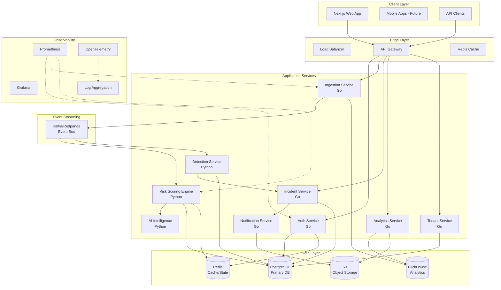
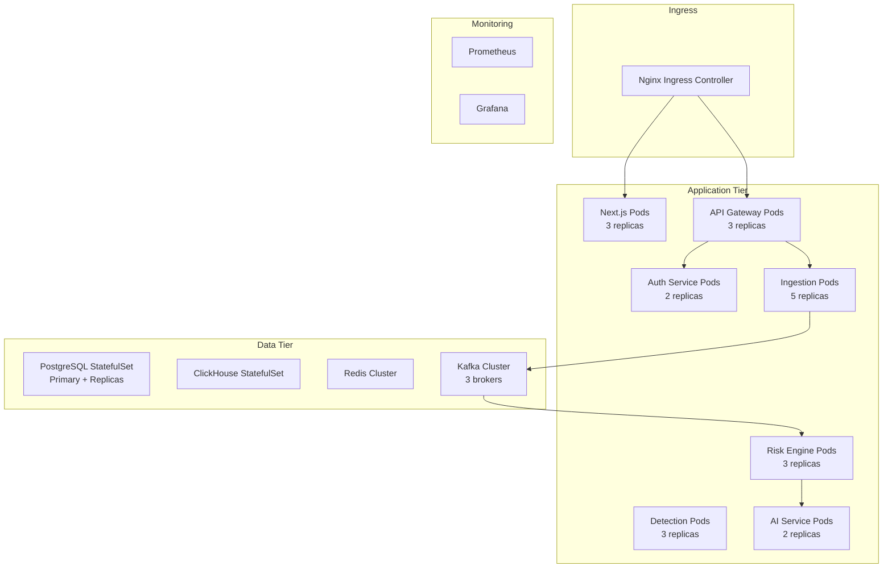

# Smart Login Guardian - Enterprise Architecture

## Executive Summary

Smart Login Guardian is an enterprise-grade identity threat detection and authentication security platform designed to monitor, analyze, and respond to authentication-based threats in real-time.

**Core Principle:** Detect → Analyze → Explain → Investigate → Respond → Learn

---

## 1. System Overview

### 1.1 Architecture Style
- **Microservices Architecture**: Independently deployable services with clear boundaries
- **Event-Driven**: Asynchronous communication via event streaming
- **Multi-Tenant**: Complete tenant isolation at database and application layers
- **Cloud-Native**: Kubernetes-ready with horizontal scaling capabilities
- **API-First**: OpenAPI-documented REST APIs with versioning

### 1.2 High-Level Architecture



---

## 2. Service Architecture

### 2.1 API Gateway
**Language:** Go  
**Responsibility:** Unified entry point, routing, rate limiting, authentication

**Key Features:**
- Request routing to backend services
- JWT token validation
- Rate limiting per tenant/user
- Request/response logging
- API versioning (v1, v2, etc.)
- CORS handling
- Request size limits
- Timeout management

**Tech Stack:**
- Go with Gin/Echo framework
- Redis for rate limiting
- OpenTelemetry for tracing

---

### 2.2 Authentication Service
**Language:** Go  
**Responsibility:** User authentication, session management, OAuth/OIDC

**Key Features:**
- User registration and login
- Password hashing (Argon2id)
- JWT token generation and validation
- API key management
- MFA support (TOTP)
- OAuth2/OIDC integration
- Session management
- Password reset workflows

**Database Tables:**
- users
- user_sessions
- api_keys
- oauth_providers
- mfa_devices

**APIs:**
```
POST   /api/v1/auth/register
POST   /api/v1/auth/login
POST   /api/v1/auth/logout
POST   /api/v1/auth/refresh
GET    /api/v1/auth/me
POST   /api/v1/auth/mfa/enable
POST   /api/v1/auth/mfa/verify
```

---

### 2.3 Login Event Ingestion Service
**Language:** Go  
**Responsibility:** High-performance authentication event ingestion and normalization

**Key Features:**
- REST API for event ingestion
- Webhook endpoints for external providers
- Event validation and normalization
- Deduplication
- Schema enforcement
- Tenant isolation
- Idempotent event processing
- Event enrichment (GeoIP, device parsing)

**Event Flow:**
1. Receive authentication event
2. Validate against schema
3. Extract tenant_id and verify authorization
4. Enrich with metadata (GeoIP lookup, device parsing)
5. Publish to Kafka topic: `auth-events`
6. Store raw event in ClickHouse
7. Return acknowledgment

**Performance Targets:**
- p95 latency: <200ms
- Throughput: 10,000 events/second per instance
- Horizontal scaling

**APIs:**
```
POST   /api/v1/events/ingest
POST   /api/v1/events/batch
POST   /api/v1/webhooks/okta
POST   /api/v1/webhooks/azure-ad
POST   /api/v1/webhooks/auth0
```

---

### 2.4 Risk Scoring Engine
**Language:** Python (FastAPI)  
**Responsibility:** Real-time risk assessment of authentication events

**Key Features:**
- Weighted multi-signal risk scoring
- Historical baseline comparison
- Configurable risk thresholds
- Signal contribution breakdown
- Risk score normalization (0-100)
- Explainable risk assessments

**Risk Signals:**
| Signal | Weight | Description |
|--------|--------|-------------|
| IP Reputation | 30 | Known malicious IP |
| Geographic Anomaly | 25 | Unusual country/city |
| Impossible Travel | 35 | Geographically impossible login sequence |
| Device Reputation | 15 | New/suspicious device |
| Login Frequency | 12 | Abnormal login rate |
| Failed Attempts | 20 | Preceding failed logins |
| Time Anomaly | 10 | Unusual time of day |
| ASN Reputation | 15 | Suspicious hosting provider |
| Anonymous Network | 25 | VPN/Tor/Proxy detection |
| MFA Behavior | 20 | Unusual MFA patterns |

**Risk Classification:**
- 0-19: Low
- 20-39: Moderate
- 40-59: Elevated
- 60-79: High
- 80-100: Critical

**Event Processing:**
```
Kafka Topic: auth-events
↓
Risk Scoring Engine
↓
Calculate risk score
↓
Store in PostgreSQL: login_risk_assessments
↓
Publish to Kafka: risk-assessments
```

---

### 2.5 Anomaly Detection Service
**Language:** Python (FastAPI)  
**Responsibility:** ML-based anomaly detection and behavioral analysis

**Key Features:**
- Isolation Forest for anomaly detection
- Statistical anomaly detection
- User behavior profiling
- Baseline learning
- Model retraining pipeline
- Feature engineering

**ML Models:**
1. **Isolation Forest**: Unsupervised anomaly detection
2. **DBSCAN**: Clustering for attack pattern identification
3. **Time Series Analysis**: Temporal pattern anomalies
4. **Behavioral Baseline**: Per-user normal behavior models

**Features:**
- Login frequency
- Geographic diversity
- Time-of-day patterns
- Device diversity
- IP diversity
- Session duration patterns
- MFA usage patterns

**Model Storage:**
- Trained models in S3
- Model metadata in PostgreSQL
- Feature cache in Redis

---

### 2.6 Threat Detection Service
**Language:** Python (FastAPI)  
**Responsibility:** Rule-based threat pattern detection

**Detectors:**

#### A. Brute Force Detector
- Threshold: 5+ failed attempts in 5 minutes
- Severity: High
- Action: Lock account temporarily

#### B. Password Spraying Detector
- Pattern: Multiple accounts, few attempts each
- Threshold: 10+ accounts from same IP
- Severity: High

#### C. Credential Stuffing Detector
- Pattern: Automated credential testing
- Indicators: Bot user-agents, high velocity
- Severity: Critical

#### D. Impossible Travel Detector
- Calculate geographic distance and time delta
- Account for VPNs and corporate networks
- Severity: Critical

#### E. Account Takeover Detector
- Correlate: New location + new device + suspicious IP
- Severity: Critical
- Action: Require MFA re-authentication

#### F. MFA Abuse Detector
- MFA fatigue attacks
- Repeated MFA failures
- Severity: High

#### G. OAuth Abuse Detector
- Unusual OAuth applications
- Suspicious redirect URIs
- Abnormal token patterns
- Severity: High

**Detection Results:**
```json
{
  "detection_id": "det_12345",
  "detector": "impossible_travel",
  "severity": "critical",
  "confidence": 0.95,
  "evidence": [...],
  "recommended_action": "revoke_session",
  "description": "User authenticated from India and US within 10 minutes"
}
```

---

### 2.7 AI Security Explanation Service
**Language:** Python (FastAPI)  
**Responsibility:** Generate natural language security explanations using LLMs

**Key Features:**
- Explain security events in plain language
- Generate investigation recommendations
- Risk scenario analysis
- Evidence-based explanations
- Multi-provider LLM support (OpenAI, Anthropic, local models)
- PII redaction before LLM processing
- Fallback to template-based explanations

**Explanation Structure:**
```json
{
  "executive_summary": "Account takeover attempt detected",
  "technical_explanation": "User authenticated from new country...",
  "risk_indicators": [...],
  "potential_attack_scenario": "Compromised credentials used by attacker",
  "evidence": [...],
  "confidence": "high",
  "investigation_steps": [...],
  "recommended_remediation": [...]
}
```

**Safety:**
- Never hallucinate evidence
- Clearly distinguish facts from hypotheses
- Redact sensitive data
- No automatic destructive actions
- Provide template fallback when LLM unavailable

---

### 2.8 Incident Management Service
**Language:** Go  
**Responsibility:** Security incident lifecycle management

**Key Features:**
- Incident creation and tracking
- Evidence timeline
- Analyst assignment
- Investigation notes
- Status transitions
- Incident correlation
- Remediation tracking

**Incident States:**
- New
- Investigating
- Confirmed
- False Positive
- Resolved
- Closed

**Database Schema:**
```sql
incidents
├── incident_id (UUID)
├── tenant_id (UUID)
├── title
├── severity (critical/high/medium/low)
├── status
├── assigned_to (user_id)
├── created_at
├── updated_at
└── resolved_at

incident_events (timeline)
├── event_id (UUID)
├── incident_id (UUID)
├── event_type
├── description
├── created_at
└── created_by

incident_notes
├── note_id (UUID)
├── incident_id (UUID)
├── author_id (UUID)
├── content
└── created_at
```

---

### 2.9 Notification Service
**Language:** Go  
**Responsibility:** Multi-channel alerting and notifications

**Channels:**
- Email (SMTP)
- Slack
- Microsoft Teams
- Webhooks
- In-app notifications
- SMS (future)

**Notification Types:**
- Critical threat alerts
- High-risk login notifications
- Account takeover warnings
- Incident assignment
- Daily/weekly reports

**Features:**
- Template management
- Deduplication
- Rate limiting
- Retry logic
- Delivery tracking
- User preferences

---

### 2.10 Organization & Tenant Management Service
**Language:** Go  
**Responsibility:** Multi-tenancy, organization management, RBAC

**Key Features:**
- Organization registration
- Tenant isolation enforcement
- Team management
- Invitation workflows
- Role-based access control
- Organization settings
- Usage tracking
- Billing metadata (future)

**Roles:**
1. Super Administrator
2. Organization Administrator
3. Security Administrator
4. Security Analyst
5. Read-only Auditor

**Permissions:**
- view_dashboard
- view_incidents
- create_incidents
- update_incidents
- view_users
- manage_users
- manage_integrations
- view_analytics
- export_data
- manage_organization

**Tenant Isolation:**
- Every database query filtered by tenant_id
- Row-level security in PostgreSQL
- API-level tenant verification
- No cross-tenant data access

---

### 2.11 Analytics Service
**Language:** Go  
**Responsibility:** Aggregated analytics and reporting

**Key Features:**
- Time-series analytics
- Risk trend analysis
- Geographic distribution
- Threat category breakdown
- User activity metrics
- Device intelligence
- IP intelligence
- Export to CSV/PDF

**Analytics Queries:**
- Total login attempts (hourly/daily/weekly)
- Success vs failed rate
- Risk score distribution
- Top suspicious IPs
- Geographic heatmap data
- Device type distribution
- Attack pattern trends

**Database:**
- ClickHouse for high-performance analytics
- Pre-aggregated materialized views
- Time-series optimized schema

---

### 2.12 Audit Logging Service
**Language:** Go  
**Responsibility:** Comprehensive audit trail

**Audit Events:**
- User actions (login, logout, settings changes)
- Admin actions (user management, configuration)
- System events (detections, incidents)
- Data access (view sensitive data)
- Configuration changes
- Integration activities

**Storage:**
- PostgreSQL for structured audit logs
- S3 for long-term archival
- Immutable append-only logs
- Retention: 7 years (configurable)

---

## 3. Data Architecture

### 3.1 PostgreSQL Schema

```sql
-- Tenants and Organizations
CREATE TABLE tenants (
    tenant_id UUID PRIMARY KEY DEFAULT gen_random_uuid(),
    name VARCHAR(255) NOT NULL,
    slug VARCHAR(100) UNIQUE NOT NULL,
    status VARCHAR(50) DEFAULT 'active',
    settings JSONB,
    created_at TIMESTAMP DEFAULT NOW(),
    updated_at TIMESTAMP DEFAULT NOW()
);

-- Users (platform users)
CREATE TABLE users (
    user_id UUID PRIMARY KEY DEFAULT gen_random_uuid(),
    email VARCHAR(255) UNIQUE NOT NULL,
    password_hash VARCHAR(255),
    full_name VARCHAR(255),
    status VARCHAR(50) DEFAULT 'active',
    email_verified BOOLEAN DEFAULT FALSE,
    last_login_at TIMESTAMP,
    created_at TIMESTAMP DEFAULT NOW(),
    updated_at TIMESTAMP DEFAULT NOW()
);

-- Tenant memberships
CREATE TABLE tenant_memberships (
    membership_id UUID PRIMARY KEY DEFAULT gen_random_uuid(),
    tenant_id UUID REFERENCES tenants(tenant_id),
    user_id UUID REFERENCES users(user_id),
    role VARCHAR(50) NOT NULL,
    created_at TIMESTAMP DEFAULT NOW(),
    UNIQUE(tenant_id, user_id)
);

-- Authentication events (hot storage)
CREATE TABLE authentication_events (
    event_id UUID PRIMARY KEY DEFAULT gen_random_uuid(),
    tenant_id UUID REFERENCES tenants(tenant_id),
    external_event_id VARCHAR(255),
    user_identifier VARCHAR(255) NOT NULL, -- email/username
    ip_address INET NOT NULL,
    country_code VARCHAR(2),
    city VARCHAR(255),
    latitude DECIMAL(10, 8),
    longitude DECIMAL(11, 8),
    device_id VARCHAR(255),
    device_type VARCHAR(50),
    browser VARCHAR(100),
    os VARCHAR(100),
    user_agent TEXT,
    authentication_method VARCHAR(50), -- password, mfa, oauth, saml
    status VARCHAR(50) NOT NULL, -- success, failed
    failure_reason VARCHAR(255),
    mfa_status VARCHAR(50),
    session_id VARCHAR(255),
    event_timestamp TIMESTAMP NOT NULL,
    ingested_at TIMESTAMP DEFAULT NOW(),
    source VARCHAR(100), -- okta, azure-ad, auth0, custom
    raw_event JSONB,
    INDEX idx_tenant_timestamp (tenant_id, event_timestamp DESC),
    INDEX idx_user_timestamp (tenant_id, user_identifier, event_timestamp DESC),
    INDEX idx_ip (ip_address),
    INDEX idx_event_id_tenant (tenant_id, external_event_id)
);

-- Risk assessments
CREATE TABLE login_risk_assessments (
    assessment_id UUID PRIMARY KEY DEFAULT gen_random_uuid(),
    tenant_id UUID REFERENCES tenants(tenant_id),
    event_id UUID REFERENCES authentication_events(event_id),
    risk_score INTEGER NOT NULL CHECK (risk_score >= 0 AND risk_score <= 100),
    risk_level VARCHAR(50) NOT NULL, -- low, moderate, elevated, high, critical
    created_at TIMESTAMP DEFAULT NOW(),
    INDEX idx_tenant_risk (tenant_id, risk_level, created_at DESC)
);

-- Risk signals
CREATE TABLE risk_signals (
    signal_id UUID PRIMARY KEY DEFAULT gen_random_uuid(),
    assessment_id UUID REFERENCES login_risk_assessments(assessment_id),
    signal_type VARCHAR(100) NOT NULL,
    signal_value INTEGER NOT NULL,
    description TEXT,
    metadata JSONB,
    created_at TIMESTAMP DEFAULT NOW()
);

-- Detection rules
CREATE TABLE detection_rules (
    rule_id UUID PRIMARY KEY DEFAULT gen_random_uuid(),
    tenant_id UUID REFERENCES tenants(tenant_id),
    name VARCHAR(255) NOT NULL,
    description TEXT,
    detector_type VARCHAR(100) NOT NULL,
    enabled BOOLEAN DEFAULT TRUE,
    severity VARCHAR(50),
    configuration JSONB,
    created_at TIMESTAMP DEFAULT NOW(),
    updated_at TIMESTAMP DEFAULT NOW()
);

-- Detection results
CREATE TABLE detection_results (
    detection_id UUID PRIMARY KEY DEFAULT gen_random_uuid(),
    tenant_id UUID REFERENCES tenants(tenant_id),
    rule_id UUID REFERENCES detection_rules(rule_id),
    event_id UUID REFERENCES authentication_events(event_id),
    detector_type VARCHAR(100) NOT NULL,
    severity VARCHAR(50) NOT NULL,
    confidence DECIMAL(3, 2),
    title VARCHAR(255),
    description TEXT,
    evidence JSONB,
    recommended_action VARCHAR(255),
    detected_at TIMESTAMP DEFAULT NOW(),
    INDEX idx_tenant_severity (tenant_id, severity, detected_at DESC)
);

-- Security incidents
CREATE TABLE security_incidents (
    incident_id UUID PRIMARY KEY DEFAULT gen_random_uuid(),
    tenant_id UUID REFERENCES tenants(tenant_id),
    title VARCHAR(255) NOT NULL,
    description TEXT,
    severity VARCHAR(50) NOT NULL,
    status VARCHAR(50) NOT NULL,
    assigned_to UUID REFERENCES users(user_id),
    affected_user_identifiers TEXT[],
    source_ip_addresses INET[],
    created_at TIMESTAMP DEFAULT NOW(),
    updated_at TIMESTAMP DEFAULT NOW(),
    resolved_at TIMESTAMP,
    INDEX idx_tenant_status (tenant_id, status, created_at DESC)
);

-- Incident events (timeline)
CREATE TABLE incident_events (
    event_id UUID PRIMARY KEY DEFAULT gen_random_uuid(),
    incident_id UUID REFERENCES security_incidents(incident_id),
    event_type VARCHAR(100) NOT NULL,
    description TEXT,
    metadata JSONB,
    created_at TIMESTAMP DEFAULT NOW(),
    created_by UUID REFERENCES users(user_id)
);

-- Devices
CREATE TABLE devices (
    device_id UUID PRIMARY KEY DEFAULT gen_random_uuid(),
    tenant_id UUID REFERENCES tenants(tenant_id),
    device_fingerprint VARCHAR(255) UNIQUE NOT NULL,
    device_type VARCHAR(50),
    os VARCHAR(100),
    browser VARCHAR(100),
    trust_status VARCHAR(50) DEFAULT 'unrecognized',
    first_seen TIMESTAMP DEFAULT NOW(),
    last_seen TIMESTAMP DEFAULT NOW(),
    associated_users TEXT[],
    INDEX idx_tenant_fingerprint (tenant_id, device_fingerprint)
);

-- IP Intelligence
CREATE TABLE ip_intelligence (
    ip_address INET PRIMARY KEY,
    reputation_score INTEGER,
    is_malicious BOOLEAN DEFAULT FALSE,
    is_vpn BOOLEAN DEFAULT FALSE,
    is_tor BOOLEAN DEFAULT FALSE,
    is_proxy BOOLEAN DEFAULT FALSE,
    asn INTEGER,
    asn_org VARCHAR(255),
    country_code VARCHAR(2),
    threat_categories TEXT[],
    last_seen TIMESTAMP,
    updated_at TIMESTAMP DEFAULT NOW()
);

-- Integrations
CREATE TABLE integrations (
    integration_id UUID PRIMARY KEY DEFAULT gen_random_uuid(),
    tenant_id UUID REFERENCES tenants(tenant_id),
    integration_type VARCHAR(100) NOT NULL, -- okta, azure-ad, slack, etc.
    name VARCHAR(255),
    enabled BOOLEAN DEFAULT TRUE,
    configuration JSONB,
    credentials JSONB, -- encrypted
    created_at TIMESTAMP DEFAULT NOW(),
    updated_at TIMESTAMP DEFAULT NOW()
);

-- Notification channels
CREATE TABLE notification_channels (
    channel_id UUID PRIMARY KEY DEFAULT gen_random_uuid(),
    tenant_id UUID REFERENCES tenants(tenant_id),
    channel_type VARCHAR(50) NOT NULL, -- email, slack, teams, webhook
    name VARCHAR(255),
    enabled BOOLEAN DEFAULT TRUE,
    configuration JSONB,
    created_at TIMESTAMP DEFAULT NOW()
);

-- Audit logs
CREATE TABLE audit_logs (
    log_id UUID PRIMARY KEY DEFAULT gen_random_uuid(),
    tenant_id UUID REFERENCES tenants(tenant_id),
    user_id UUID REFERENCES users(user_id),
    action VARCHAR(255) NOT NULL,
    resource_type VARCHAR(100),
    resource_id VARCHAR(255),
    details JSONB,
    ip_address INET,
    created_at TIMESTAMP DEFAULT NOW(),
    INDEX idx_tenant_created (tenant_id, created_at DESC)
);

-- AI explanations
CREATE TABLE ai_explanations (
    explanation_id UUID PRIMARY KEY DEFAULT gen_random_uuid(),
    tenant_id UUID REFERENCES tenants(tenant_id),
    event_id UUID REFERENCES authentication_events(event_id),
    incident_id UUID REFERENCES security_incidents(incident_id),
    explanation_type VARCHAR(100),
    executive_summary TEXT,
    technical_explanation TEXT,
    risk_indicators JSONB,
    investigation_steps JSONB,
    confidence VARCHAR(50),
    model_used VARCHAR(100),
    created_at TIMESTAMP DEFAULT NOW()
);
```

### 3.2 ClickHouse Schema (Analytics)

```sql
-- Authentication events (cold storage & analytics)
CREATE TABLE auth_events_analytics (
    event_id UUID,
    tenant_id UUID,
    user_identifier String,
    ip_address IPv4,
    country_code FixedString(2),
    city String,
    device_type String,
    browser String,
    os String,
    auth_method String,
    status String,
    risk_score UInt8,
    risk_level String,
    event_timestamp DateTime,
    ingested_at DateTime DEFAULT now()
) ENGINE = MergeTree()
PARTITION BY toYYYYMM(event_timestamp)
ORDER BY (tenant_id, event_timestamp, user_identifier)
TTL event_timestamp + INTERVAL 2 YEAR;

-- Materialized view for hourly aggregations
CREATE MATERIALIZED VIEW auth_events_hourly
ENGINE = SummingMergeTree()
PARTITION BY toYYYYMM(hour)
ORDER BY (tenant_id, hour, status)
AS SELECT
    tenant_id,
    toStartOfHour(event_timestamp) AS hour,
    status,
    count() AS event_count,
    uniq(user_identifier) AS unique_users,
    uniq(ip_address) AS unique_ips
FROM auth_events_analytics
GROUP BY tenant_id, hour, status;
```

---

## 4. Event Streaming Architecture

### 4.1 Kafka Topics

```
auth-events                    # Raw authentication events
├── Partitions: 10
├── Retention: 7 days
└── Consumers: risk-engine, detection-service, analytics

risk-assessments               # Risk scoring results
├── Partitions: 10
├── Retention: 7 days
└── Consumers: detection-service, incident-service

detection-results              # Threat detections
├── Partitions: 5
├── Retention: 30 days
└── Consumers: incident-service, notification-service

security-incidents             # Incident creation/updates
├── Partitions: 5
├── Retention: 90 days
└── Consumers: notification-service, analytics-service

audit-events                   # Audit trail
├── Partitions: 5
├── Retention: 365 days
└── Consumers: audit-logging-service
```

### 4.2 Event Schemas (JSON)

#### Authentication Event
```json
{
  "event_id": "evt_123",
  "tenant_id": "tenant_001",
  "user_identifier": "user@example.com",
  "ip_address": "203.0.113.10",
  "country_code": "IN",
  "city": "Pune",
  "latitude": 18.5204,
  "longitude": 73.8567,
  "device_id": "device_abc",
  "device_type": "desktop",
  "browser": "Chrome",
  "os": "macOS",
  "user_agent": "Mozilla/5.0...",
  "authentication_method": "password_mfa",
  "status": "success",
  "failure_reason": null,
  "mfa_status": "passed",
  "session_id": "sess_xyz",
  "event_timestamp": "2026-11-13T10:30:00Z",
  "source": "okta"
}
```

---

## 5. Security Architecture

### 5.1 Authentication & Authorization
- **User Authentication**: JWT tokens with refresh tokens
- **API Authentication**: API keys with rate limiting
- **Service-to-Service**: mTLS or service accounts with short-lived tokens
- **MFA**: TOTP-based two-factor authentication
- **OAuth2/OIDC**: External identity provider integration

### 5.2 Data Security
- **Encryption in Transit**: TLS 1.3 for all communications
- **Encryption at Rest**: PostgreSQL transparent data encryption, encrypted S3 buckets
- **Secrets Management**: HashiCorp Vault or Kubernetes Secrets
- **Password Hashing**: Argon2id with unique salt
- **PII Protection**: Field-level encryption for sensitive data

### 5.3 Tenant Isolation
- **Database**: Row-level security with tenant_id filtering
- **Application**: Middleware enforces tenant context
- **Storage**: Tenant-specific S3 prefixes
- **No Cross-Tenant Access**: Verified at every service boundary

### 5.4 Security Controls
- Rate limiting (per IP, per user, per tenant)
- Input validation and sanitization
- SQL injection prevention (parameterized queries)
- XSS protection
- CSRF tokens for state-changing operations
- Content Security Policy
- Secure HTTP headers
- Dependency vulnerability scanning
- Container image scanning

---

## 6. Frontend Architecture

### 6.1 Technology Stack
- **Framework**: Next.js 14+ with App Router
- **Language**: TypeScript
- **Styling**: Tailwind CSS
- **Components**: shadcn/ui
- **State Management**: TanStack Query + Zustand
- **Forms**: React Hook Form + Zod
- **Charts**: Recharts
- **Icons**: Lucide React
- **Maps**: Mapbox GL JS

### 6.2 Application Structure
```
apps/web/
├── app/
│   ├── (auth)/
│   │   ├── login/
│   │   ├── register/
│   │   └── reset-password/
│   ├── (dashboard)/
│   │   ├── overview/
│   │   ├── monitoring/
│   │   ├── events/
│   │   ├── threats/
│   │   ├── incidents/
│   │   ├── intelligence/
│   │   ├── investigation/
│   │   ├── reports/
│   │   └── settings/
│   ├── api/                  # API routes
│   └── layout.tsx
├── components/
│   ├── ui/                   # shadcn/ui components
│   ├── dashboard/
│   ├── charts/
│   ├── tables/
│   └── forms/
├── lib/
│   ├── api-client.ts
│   ├── auth.ts
│   └── utils.ts
├── hooks/
└── types/
```

### 6.3 Key Pages

**1. Overview Dashboard**
- Login activity metrics
- Risk distribution charts
- Geographic map
- Recent threats
- Critical alerts

**2. Live Login Monitoring**
- Real-time event stream
- Risk-based highlighting
- Search and filters
- Event detail drawer

**3. Threat Detection**
- Active detections list
- Severity filtering
- Threat timeline
- Evidence viewer

**4. Security Incidents**
- Incident management board
- Investigation workspace
- Evidence timeline
- Analyst collaboration

**5. Risk Intelligence**
- User risk profiles
- Device intelligence
- IP reputation database
- Geographic analytics

**6. Investigation Center**
- Cross-reference analysis
- Event correlation
- Timeline reconstruction
- Evidence collection

**7. AI Security Assistant**
- Natural language queries
- Automated explanations
- Investigation recommendations

---

## 7. Deployment Architecture

### 7.1 Kubernetes Architecture



### 7.2 Resource Requirements (Production)

**Small Deployment (< 100K events/day):**
- API Gateway: 2 CPU, 4GB RAM × 2 replicas
- Auth Service: 1 CPU, 2GB RAM × 2 replicas
- Ingestion: 2 CPU, 4GB RAM × 3 replicas
- Risk Engine: 4 CPU, 8GB RAM × 2 replicas
- PostgreSQL: 4 CPU, 16GB RAM
- Redis: 2 CPU, 4GB RAM
- Kafka: 2 CPU, 4GB RAM × 3 brokers

**Medium Deployment (100K-1M events/day):**
- Scale horizontally with autoscaling

### 7.3 CI/CD Pipeline

```yaml
# .github/workflows/deploy.yml
name: Deploy Smart Login Guardian

on:
  push:
    branches: [main]

jobs:
  test:
    - Run unit tests
    - Run integration tests
    - Security scanning
    - Lint checks

  build:
    - Build container images
    - Tag with git SHA
    - Push to registry
    - Scan images

  deploy:
    - Update Helm values
    - Deploy to staging
    - Run smoke tests
    - Deploy to production
    - Health checks
```

---

## 8. Observability

### 8.1 Metrics
- Request rate, latency, error rate per service
- Event ingestion throughput
- Risk scoring latency
- Detection engine performance
- Database connection pool metrics
- Kafka consumer lag
- Cache hit rates

### 8.2 Logging
- Structured JSON logs
- Log levels: DEBUG, INFO, WARN, ERROR
- Correlation IDs across services
- ELK/Loki for log aggregation

### 8.3 Tracing
- OpenTelemetry distributed tracing
- Request flow visualization
- Performance bottleneck identification

### 8.4 Alerting
- High error rate
- Service unavailability
- Database performance degradation
- Kafka consumer lag
- Disk space alerts
- Security anomalies

---

## 9. Performance Targets

| Metric | Target | Measurement |
|--------|--------|-------------|
| Event Ingestion Latency (p95) | < 200ms | End-to-end from API to Kafka |
| Risk Scoring Latency (p95) | < 100ms | From Kafka to DB write |
| Dashboard Load Time (p95) | < 500ms | API response time |
| Alert Delivery (p95) | < 5s | From detection to notification |
| Event Throughput | 10K events/sec | Per ingestion instance |
| Database Query (p95) | < 50ms | Dashboard queries |

---

## 10. Disaster Recovery

### 10.1 Backup Strategy
- **PostgreSQL**: Daily full backups, WAL archiving for PITR
- **ClickHouse**: Daily snapshots
- **Kafka**: Topic replication factor 3
- **S3**: Cross-region replication

### 10.2 RPO/RTO
- Recovery Point Objective: < 1 hour
- Recovery Time Objective: < 4 hours

---

## 11. Compliance & Standards

- **SOC 2 Type II**: Security controls and monitoring
- **GDPR**: Data privacy, right to erasure, data portability
- **ISO 27001**: Information security management
- **NIST Cybersecurity Framework**: Detection, response capabilities
- **OWASP Top 10**: Application security best practices

---

## 12. Technology Decisions Rationale

### Why Go for high-performance services?
- Low latency, high throughput
- Excellent concurrency model
- Small binary size
- Fast compilation

### Why Python for AI/ML?
- Rich ecosystem (scikit-learn, TensorFlow)
- LLM integration libraries
- Fast iteration for ML experimentation

### Why PostgreSQL?
- ACID compliance
- Rich SQL features
- Row-level security for multi-tenancy
- JSON support

### Why ClickHouse?
- Columnar storage for analytics
- Excellent time-series performance
- Real-time aggregations
- Horizontal scaling

### Why Kafka?
- High throughput event streaming
- Durable message storage
- Decouples services
- Replay capability

### Why Next.js?
- React Server Components
- App Router for modern routing
- API routes
- SSR/SSG capabilities
- Great developer experience

---

## 13. Future Enhancements

**Phase 2:**
- Machine learning model auto-retraining
- Advanced behavioral analytics
- Mobile app
- Browser extension

**Phase 3:**
- Automated response playbooks
- SOAR integration
- Custom detection rules DSL
- Threat hunting workbench

**Phase 4:**
- On-premise deployment option
- FedRAMP compliance
- Advanced AI models
- Predictive threat intelligence

---

## Conclusion

This architecture provides a solid foundation for a production-grade, enterprise-ready identity threat detection platform that can scale to millions of authentication events per day while maintaining low latency, high availability, and comprehensive security.

The microservices approach ensures:
- Independent scaling
- Technology flexibility
- Fault isolation
- Team autonomy

The multi-tenant design ensures:
- Complete data isolation
- Organization-level customization
- Efficient resource utilization

The event-driven architecture ensures:
- Real-time threat detection
- System decoupling
- Audit trail
- Replay capability
